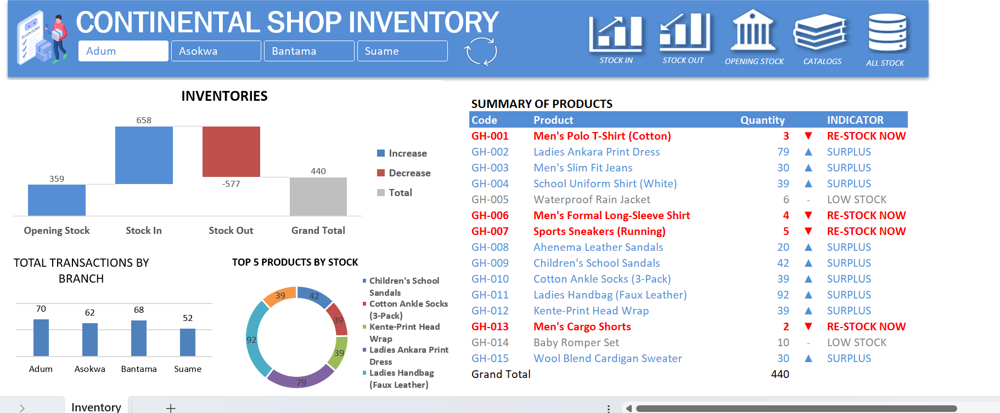
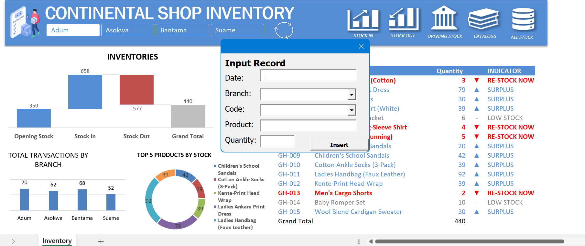
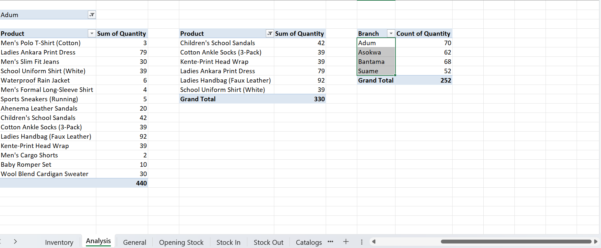

# Automated Retail Inventory Management System (Excel & VBA)

## 📌 Project Overview
This project is an end-to-end, automated data application built entirely within Microsoft Excel to streamline inventory tracking across four regional retail branches (**Adum, Asokwa, Bantama, and Suame**). 

By leveraging **VBA (Visual Basic for Applications)**, custom **User Forms**, and relational data structures, this system transforms raw transaction tracking into a smooth, user-friendly software experience. It eliminates human entry errors, automates backend ledger updates, and provides real-time supply chain insights via an interactive KPI dashboard.

---

## 🛠️ Tech Stack & Advanced Features Used
*   **Excel VBA / Macros:** Developed backend scripts for custom user form logic, dynamic button routing, navigation control, and asynchronous database updates.
*   **User Forms:** Engineered structured UI pop-up menus for data entry validation.
*   **Advanced Logic Formulas:** Used nested logical conditions (`IF`, `AND`, `SUMIFS`) to drive automated inventory alerts.
*   **Data Modeling & Pivot Tables:** Established an organized architecture utilizing hidden operational sheets to handle complex multi-branch calculations seamlessly.
*   **Interactive UI/UX Design:** Designed a custom dashboard complete with functional symbol buttons, icon anchors, and multi-branch slicers.

---

## 📐 System Architecture & Workflow

The system is built on a "Frontend Dashboard / Hidden Backend Engine" architecture. This keeps messy, complex data tables safely tucked away from the end user while maintaining lightning-fast performance.

### 1. The Interactive Dashboard (Frontend)
The primary user interface houses interactive control icons, branch slicers, dynamic performance charts, and the core inventory summary tracker.

[Dashboard Interface]
├── Navigation & Action Buttons (VBA Routed)
├── Branch Slicers (Adum, Asokwa, Bantama, Suame)
└── Real-Time Inventory Summary Table (With Logic Alerts)

### 2. The Hidden Database Engine (Backend)
To protect data integrity, core tracking sheets are kept programmatically hidden. These sheets handle the foundational logging data:
*   **Opening Stock Sheet:** Establishes initial baseline quantities.
*   **Stock-In Sheet:** Appends incoming product inventory records sequentially.
*   **Stock-Out Sheet:** Logs outgoing product sales and transfers.
*   **Catalogs Sheet:** Manages global product metadata, unique codes, and descriptions.
*   **General Sheet:** A unified data ledger consolidating all entries across all branches.

---

## 🚀 Key Functional Features Explained

### A. Automated Ingestion via VBA User Forms
Clicking the **Stock-In** or **Stock-Out** buttons triggers a custom pop-up entry window. Users enter essential data point metrics (Date, Branch, Product Code, Product Name, Quantity). Clicking "Submit" runs a VBA script that automatically appends the record as the absolute last row of the corresponding hidden ledger sheet, preventing accidental overwrites.

### B. Dynamic Inventory Status Engine
The central summary table continuously monitors warehouse quantities using strict conditional boundaries. It calculates stock health and triggers immediate visual color-coded warnings:

| Inventory Status | Logical Condition | Dashboard Visual | Business Action |
| :--- | :--- | :--- | :--- |
| 🚨 **RE-STOCK NOW** | `Quantity <= 5` | Bold Red Highlight | Immediate procurement order required |
| ⚠️ **LOW STOCK** | `Quantity > 5` AND `Quantity <= 15` | Soft Warning | Add item to weekly ordering pipeline |
| 🟢 **SURPLUS** | `Quantity > 15` | Normal Tracker | Optimum stock level maintained |

### C. Single-Click Architecture Refresh
To ensure rapid performance, heavy backend calculations do not run constantly in the background. Instead, users click a highly accessible **Refresh** button positioned right beneath the main title, which triggers an optimized macro to instantly recalculate all pivot tables, summary counts, and alert conditions.

---

## 📊 Visual Gallery

*(Note to Reviewers: Below are visual interface snapshots of the live operational system)*

### 1. Main Management Dashboard

### 2. Dynamic VBA Stock-In User Form Popup (Input Record)

### 3. Dynamic VBA Stock-Out User Form Popup (Output Record)

### 4. Hidden Relational Calculation Sheets

---

## 💡 Business Impact & Key Takeaways
1. **Reduced Human Error:** Standardizing inventory inputs through automated User Forms cut down data input formatting errors completely.
2. **Optimized Procurement:** The automated 3-tier visual threshold script ensures managers can spot critical stock shortages (`<= 5` units) instantly, protecting the business from costly out-of-stock scenarios.
3. **Data Decentralization:** Consolidating multi-branch metrics via interactive slicers empowers stakeholders to filter performance by regional location instantly, replacing hours of manual filtering.
